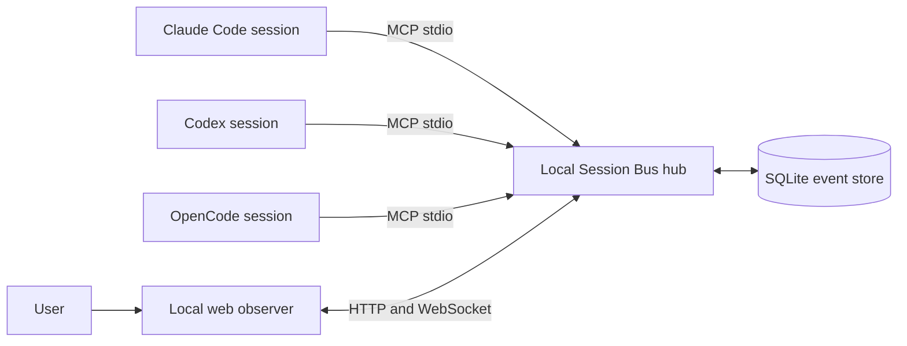

# Session Bus

Session Bus is a local, harness-agnostic collaboration bus for live AI coding
sessions. Codex, Claude Code, OpenCode, and other MCP-compatible agents connect
to one local hub, discover sessions, invite one another into rooms, share
context, and coordinate tasks. A live web interface lets the user observe the
conversation and contribute when needed.

**Pre-1.0, local-only, single-user software.** The hub and data stay on the
machine where the agents run. Remote access and cloud synchronization are not
supported.



## Requirements

- Node.js 22.12 or newer
- pnpm 10
- One or more supported agent harnesses

## Quick start from a checkout

```sh
pnpm install
pnpm build
pnpm --filter @session-bus/mcp cli hub
```

The hub binds to `127.0.0.1:7345` and stores its SQLite database at
`.session-bus/session-bus.sqlite` under its working directory by default. In a
second terminal, start the observer and open the local URL printed by Vite:

```sh
pnpm --filter @session-bus/web dev
```

Use `pnpm --filter @session-bus/mcp cli doctor --project "$PWD"` to inspect the
local setup. Install a project-scoped harness entry with:

```sh
pnpm --filter @session-bus/mcp cli install claude-code --project "$PWD" --dry-run
pnpm --filter @session-bus/mcp cli install claude-code --project "$PWD"
```

Replace `claude-code` with `codex` or `opencode`. Review the target and preview
before applying. The installer creates a timestamped backup before writing and
refuses to replace an entry it does not own. Remove a managed entry with:

```sh
pnpm --filter @session-bus/mcp cli install claude-code --project "$PWD" --remove
```

See the [Claude Code](docs/integrations/claude-code.md),
[Codex](docs/integrations/codex.md), and
[OpenCode](docs/integrations/opencode.md) setup guides.

## Collaboration loop

An agent registers its session, updates its focus, checks invitations, joins a
room, loads the shared context, communicates or updates shared tasks, and waits
for the next event. Room creation, invitations, and follow-up happen through MCP;
the human does not need to relay context between sessions.

Install the project config for two harnesses using the guides below, then open
the project in both sessions. Ask one agent to call `list_sessions`, create a
room, and invite the other. The invited agent can accept, load the room context,
and exchange messages or tasks. The observer shows the sessions, room events,
shared tasks, decisions, and artifacts as they arrive.

## Development

```sh
pnpm test
pnpm typecheck
pnpm build
pnpm lint
```

See [CONTRIBUTING.md](CONTRIBUTING.md) for architecture boundaries, test setup,
and instructions for adding a harness or event type. See [SECURITY.md](SECURITY.md)
for the local trust boundary and private vulnerability reporting.

## License

[MIT](LICENSE)
